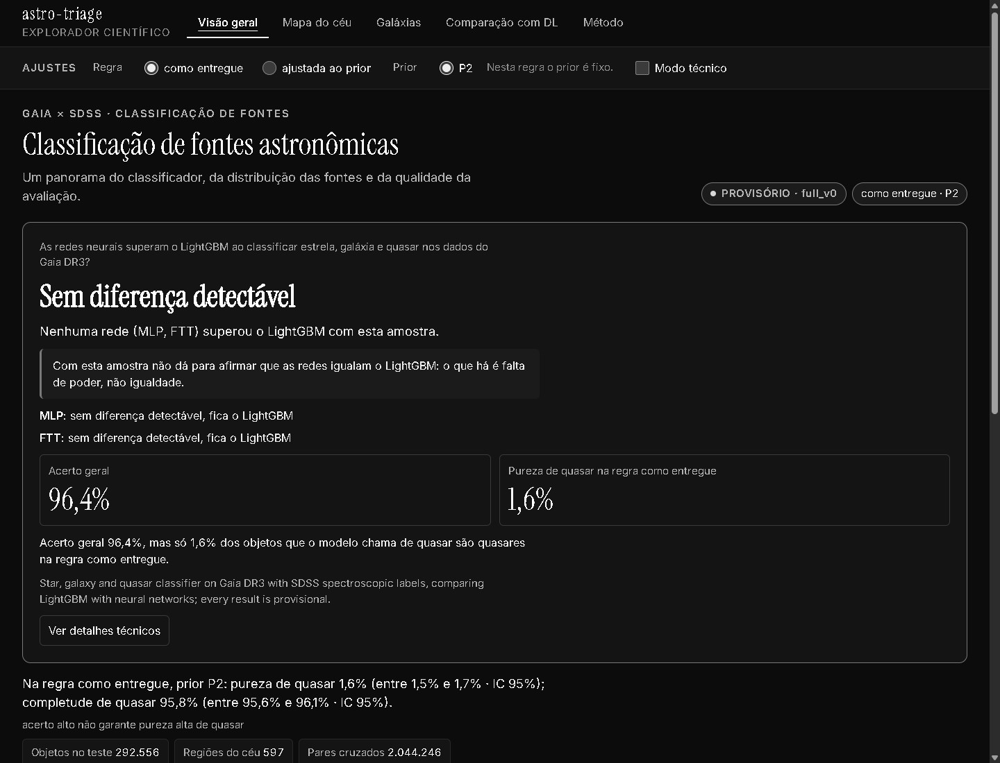
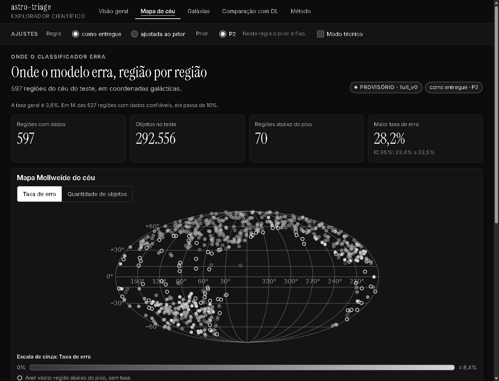
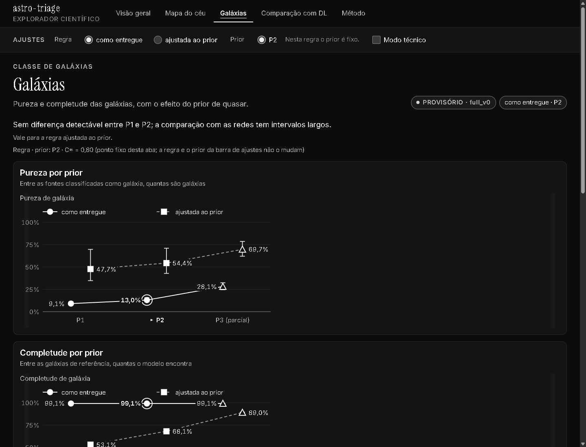
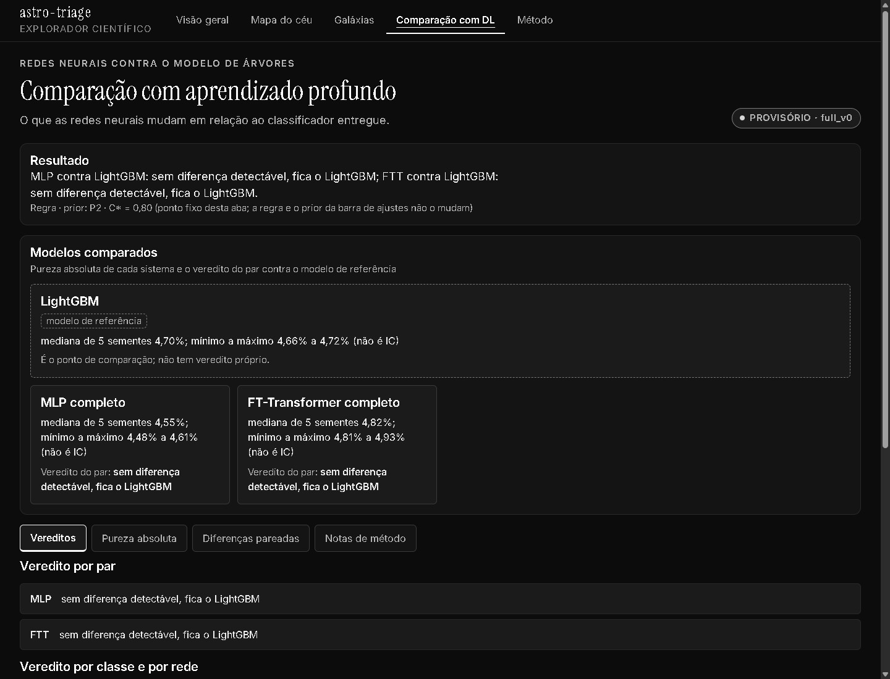
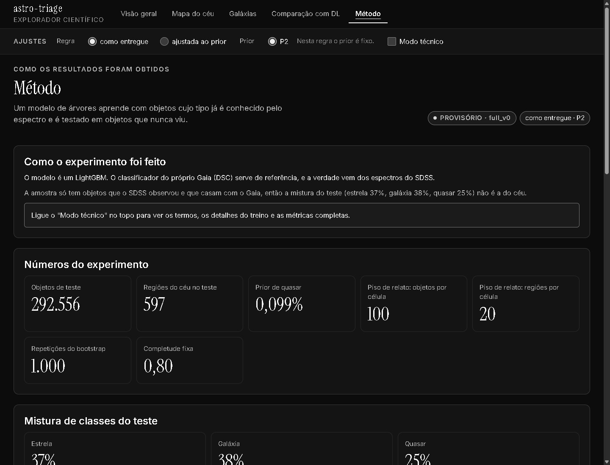
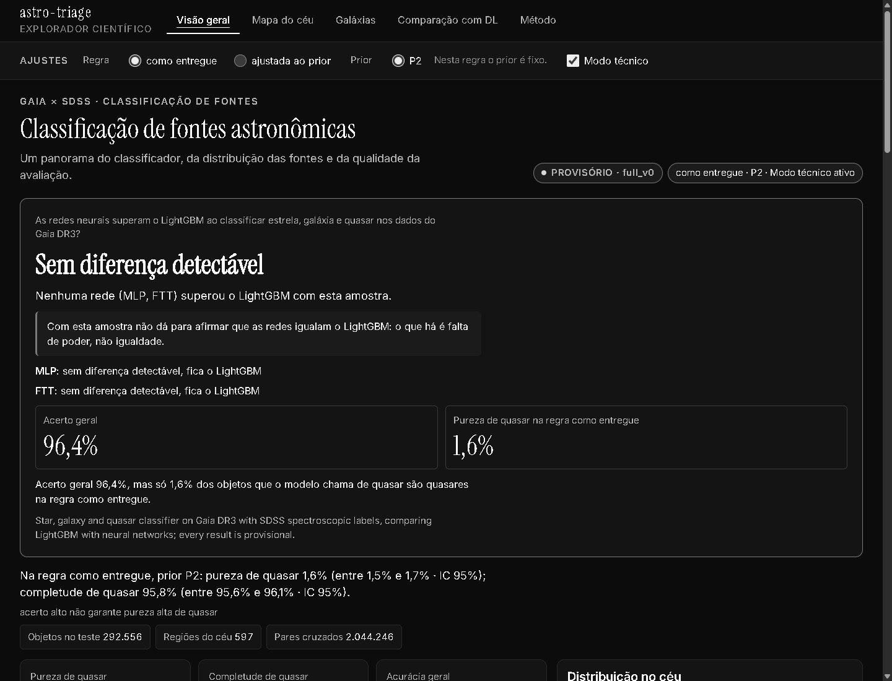

# astro-triage

[](https://github.com/lellisz/astro-triage/actions/workflows/ci.yml) [](LICENSE)

[English](#english) | [Português](#português)

## English

### What it is
astro-triage classifies Gaia DR3 sources as STAR, GALAXY or QSO, using SDSS spectroscopic labels.
The main model is LightGBM with calibration, evaluated against the Gaia DSC classifier as baseline.
It also compares LightGBM with two deep-learning models, an MLP and an FT-Transformer.
A static website (`web/`) presents the results.

> **Do neural networks beat LightGBM on this task? "No detectable difference."**
> No network (MLP, FT-Transformer) beat LightGBM with this sample. With this sample we also cannot claim they match it: what we have is lack of statistical power, not equality.

**Why accuracy misleads.** Under the "as delivered" rule, overall accuracy is 96.4%, yet only 1.6% of the objects the model calls quasars really are quasars (95% CI from 1.5% to 1.7%). Quasar completeness is 95.8%. The test set has 292,556 objects. These numbers come from the `full_v0` release and are PROVISIONAL.


*Overview page: the central answer and the accuracy versus quasar purity contrast.*

### Status and limitations
**All metrics are PROVISIONAL.**
- Some cells are below the reporting floor (at least 100 objects in at least 20 sky pixels per class) and are marked n/a. ADR 0006 (deep-learning comparison protocol) is still Proposed.
- The labels come from SDSS and carry the selection bias of the crossmatch with Gaia: the match rate is 91.1% for STAR, 65.7% for QSO and 31.1% for GALAXY.
- Part of Gaia DSC was trained on SDSS objects, so scoring it on SDSS labels is partly circular (ADR 0002).
- The population has no magnitude cut (see the ADR 0001 amendment).

### Project status
- Phase 1 (LightGBM on the `full_v0` dataset, evaluation vs Gaia DSC): done, provisional.
- Layer 2 (Nemotron via NVIDIA API): closed without test evaluation (ADR 0005, Amendment 2).
- Deep-learning comparison (MLP and FT-Transformer vs LightGBM): executed once on the test set under the ADR 0006 protocol; results are aggregates only, provisional, and the test must not be opened again without a new ADR.
- Website (`web/`, Next.js reading JSON exported by Python): 5 pages (Overview, Sky map, Galaxies, Comparison with DL, Method), each with a "technical mode" toggle. ADR 0008 is Proposed and becomes Accepted before the first public deploy. The site shows only aggregates exported by `python -m astro_triage.web_export`, never per-object data. It replaces the old Streamlit dashboard.

### Site gallery
Screenshots of the site, one per page. The interface text is in Portuguese. Every figure shown is PROVISIONAL.


*Sky map: where the model errs, region by region; hollow rings mark regions with too few objects to report.*


*Galaxies: purity and completeness under different quasar priors.*


*Comparison with DL: each network against LightGBM, with the verdict "no detectable difference".*


*Method: how the experiment was built and its main numbers.*


*Technical mode: the same page with the extra detail for readers who want to check the numbers.*

### How to run
The repository has code, tests and documentation only. **The raw data are not in the repository**: exporting the numbers needs the local data folder. The tests do not need the data (43 of them are skipped without it).

Requirements: Python 3.12 (the pinned versions in `requirements.txt` were smoke-tested on CPython 3.12.5) and, to build the site, Node.js 20.9 or newer (`engines` in `web/package.json`). There is no `pyproject.toml`; dependencies are in `requirements.txt` (`requirements-dl.txt` adds `torch` for the deep-learning comparison and is not needed for the site).

**1. Create the environment and install the dependencies**

PowerShell (Windows):
```powershell
py -3.12 -m venv .venv
.venv\Scripts\python.exe -m pip install -r requirements.txt
```

bash (Linux/macOS/Git Bash):
```bash
python3.12 -m venv .venv
.venv/bin/python -m pip install -r requirements.txt
```
(In Git Bash on Windows, use `.venv/Scripts/python.exe` instead.)

**2. Point to the data (only if needed)**

The export reads `<data root>/interim/<release>/`; the release is `full_v0`. The data root is the `ASTRO_DATA_ROOT` environment variable when set, otherwise the `data/` folder at the repository root. Set it only if your data live elsewhere:

PowerShell:
```powershell
$env:ASTRO_DATA_ROOT = "D:\path\to\data"
```

bash:
```bash
export ASTRO_DATA_ROOT=/path/to/data
```

**3. Run the tests**

PowerShell:
```powershell
.venv\Scripts\python.exe -m pytest -q
```

bash:
```bash
.venv/bin/python -m pytest -q
```

**4. Export the numbers and build the site**

PowerShell:
```powershell
.venv\Scripts\python.exe -m astro_triage.web_export --release full_v0 --out web\data
cd web
$env:ASTRO_RELEASE = "full_v0"; $env:ASTRO_WEB_DATA = "$PWD\data"
npm ci; npm run build
```

The export writes only aggregates, to `<out>/<release>` (here `web\data\full_v0`). The build needs `ASTRO_RELEASE` to name that release and `ASTRO_WEB_DATA` to point to the `data` folder. The static site lands in `web/out/`.

**5. View it locally**

```powershell
cd ..
.venv\Scripts\python.exe -m http.server 3100 --directory web\out
```
Then open `http://localhost:3100`. See `docs/adr/0008-web-frontend-nextjs-static-json.md` for the design decision.

### Data policy
- No raw data in the repository; terms are in `manifests/README.md`.
- Gaia data licence: CC BY-NC 3.0 IGO.
- Citations are pending verification (see `manifests/README.md`).
- The repository is public and holds code, tests and documentation only; the data are not redistributed here.

## Português

### O que é
O astro-triage classifica fontes do Gaia DR3 como STAR, GALAXY ou QSO, usando rótulos espectroscópicos do SDSS.
O modelo principal é o LightGBM com calibração, avaliado contra o classificador Gaia DSC como baseline.
Também compara o LightGBM com dois modelos de deep learning, um MLP e um FT-Transformer.
Um site estático (`web/`) apresenta os resultados.

> **As redes neurais superam o LightGBM nesta tarefa? "Sem diferença detectável."**
> Nenhuma rede (MLP, FT-Transformer) superou o LightGBM com esta amostra. Com esta amostra também não dá para afirmar que elas igualam o LightGBM: o que há é falta de poder estatístico, não igualdade.

**Por que o acerto engana.** Na regra "como entregue", o acerto geral é 96,4%, mas só 1,6% dos objetos que o modelo chama de quasar são quasares (IC de 95% de 1,5% a 1,7%). A completude de quasar é 95,8%. O conjunto de teste tem 292.556 objetos. Esses números vêm da release `full_v0` e são PROVISÓRIOS.


*Página Visão geral: a resposta central e o contraste entre acerto e pureza de quasar.*

### Status e limitações
**Todas as métricas são PROVISÓRIAS.**
- Algumas células ficam abaixo do piso de reporte (mínimo de 100 objetos em 20 pixels do céu por classe) e aparecem marcadas como n/a. A ADR 0006 (protocolo de comparação com deep learning) ainda está Proposed.
- Os rótulos vêm do SDSS e carregam o viés de seleção do cruzamento com o Gaia: a taxa de match é 91,1% para STAR, 65,7% para QSO e 31,1% para GALAXY.
- Parte do Gaia DSC foi treinada com objetos do SDSS, então avaliá-lo com rótulos do SDSS é parcialmente circular (ADR 0002).
- A população não tem corte de magnitude (ver a emenda da ADR 0001).

### Estado do projeto
- Fase 1 (LightGBM no dataset `full_v0`, avaliação vs Gaia DSC): concluída, provisória.
- Camada 2 (Nemotron via API NVIDIA): encerrada sem avaliação em teste (ADR 0005, Emenda 2).
- Comparação com deep learning (MLP e FT-Transformer vs LightGBM): executada uma vez no teste pelo protocolo da ADR 0006; resultados só em agregados, provisórios, e o teste não pode ser aberto de novo sem uma nova ADR.
- Site (`web/`, Next.js lendo JSON exportado pelo Python): 5 páginas (Visão geral, Mapa do céu, Galáxias, Comparação com DL, Método), cada uma com o "Modo técnico". A ADR 0008 está Proposed e passa a Accepted antes do primeiro deploy público. O site mostra só agregados exportados por `python -m astro_triage.web_export`, nunca dado por objeto. Ele substitui o antigo dashboard em Streamlit.

### Galeria do site
Capturas de tela do site, uma por página. O texto da interface é em português. Todo valor mostrado é PROVISÓRIO.


*Mapa do céu: onde o modelo erra, região por região; anéis vazados marcam regiões com poucos objetos para reportar.*


*Galáxias: pureza e completude com diferentes priors de quasar.*


*Comparação com DL: cada rede contra o LightGBM, com o veredito "sem diferença detectável".*


*Método: como o experimento foi montado e seus números principais.*


*Modo técnico: a mesma página com mais detalhe, para quem quer conferir os números.*

### Como executar
O repositório tem só código, testes e documentação. **Os dados brutos não estão no repositório**: exportar os números exige a pasta de dados local. Os testes não precisam dos dados (43 deles são pulados sem eles).

Requisitos: Python 3.12 (as versões fixadas em `requirements.txt` foram testadas no CPython 3.12.5) e, para gerar o site, Node.js 20.9 ou superior (`engines` em `web/package.json`). Não há `pyproject.toml`; as dependências estão em `requirements.txt` (`requirements-dl.txt` acrescenta o `torch` da comparação com deep learning e não é necessário para o site).

**1. Criar o ambiente e instalar as dependências**

PowerShell (Windows):
```powershell
py -3.12 -m venv .venv
.venv\Scripts\python.exe -m pip install -r requirements.txt
```

bash (Linux/macOS/Git Bash):
```bash
python3.12 -m venv .venv
.venv/bin/python -m pip install -r requirements.txt
```
(No Git Bash do Windows, use `.venv/Scripts/python.exe`.)

**2. Apontar para os dados (só se precisar)**

A exportação lê `<raiz dos dados>/interim/<release>/`; a release é `full_v0`. A raiz dos dados é a variável de ambiente `ASTRO_DATA_ROOT`, quando definida, ou a pasta `data/` na raiz do repositório. Defina a variável só se os dados estiverem em outro lugar:

PowerShell:
```powershell
$env:ASTRO_DATA_ROOT = "D:\caminho\para\data"
```

bash:
```bash
export ASTRO_DATA_ROOT=/caminho/para/data
```

**3. Rodar os testes**

PowerShell:
```powershell
.venv\Scripts\python.exe -m pytest -q
```

bash:
```bash
.venv/bin/python -m pytest -q
```

**4. Exportar os números e gerar o site**

PowerShell:
```powershell
.venv\Scripts\python.exe -m astro_triage.web_export --release full_v0 --out web\data
cd web
$env:ASTRO_RELEASE = "full_v0"; $env:ASTRO_WEB_DATA = "$PWD\data"
npm ci; npm run build
```

A exportação grava só agregados, em `<out>/<release>` (aqui `web\data\full_v0`). O build precisa de `ASTRO_RELEASE` com o nome dessa release e de `ASTRO_WEB_DATA` apontando para a pasta `data`. O site estático fica em `web/out/`.

**5. Ver localmente**

```powershell
cd ..
.venv\Scripts\python.exe -m http.server 3100 --directory web\out
```
Depois abra `http://localhost:3100`. Veja `docs/adr/0008-web-frontend-nextjs-static-json.md` para a decisão de projeto.

### Política de dados
- Nenhum dado bruto no repositório; os termos estão em `manifests/README.md`.
- Licença dos dados Gaia: CC BY-NC 3.0 IGO.
- Citações pendentes de verificação (ver `manifests/README.md`).
- O repositório é público e contém só código, testes e documentação; os dados não são redistribuídos aqui.
