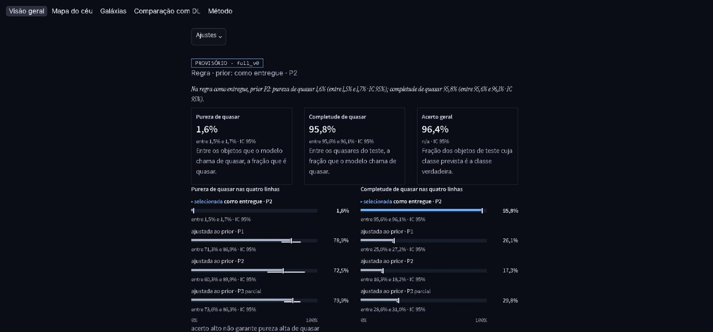
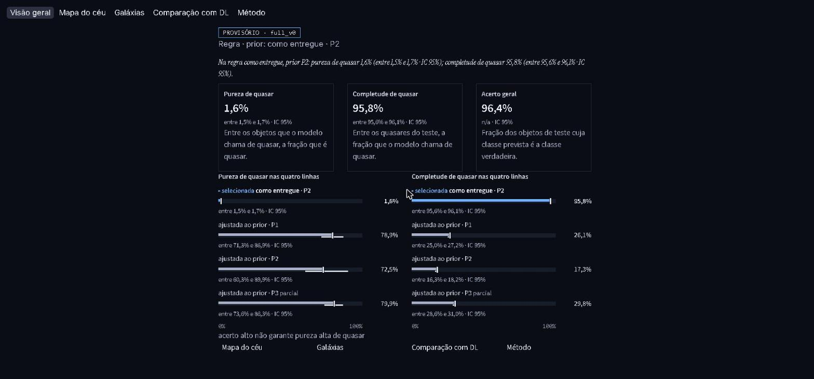
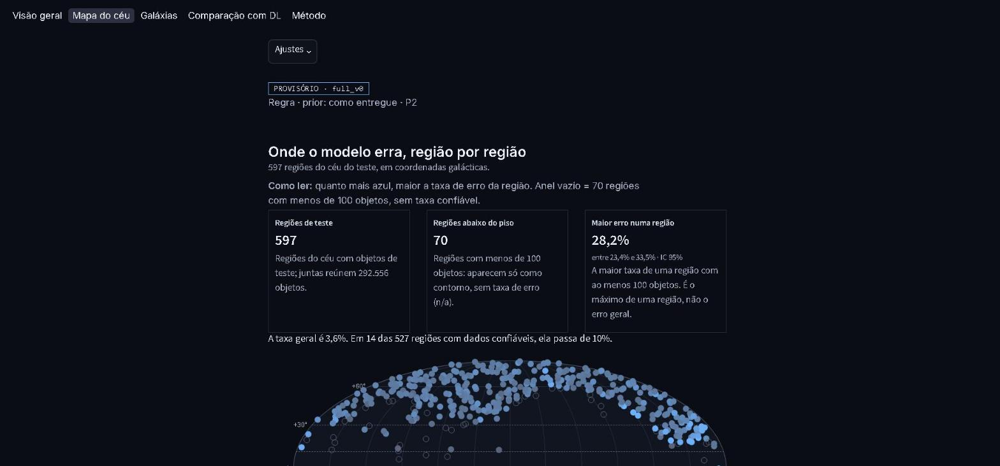
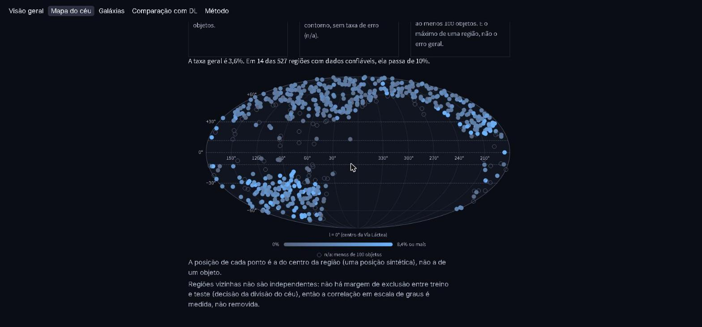
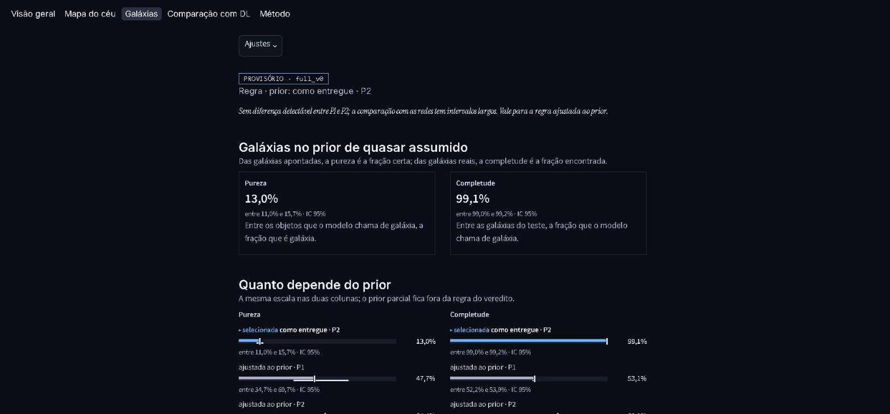
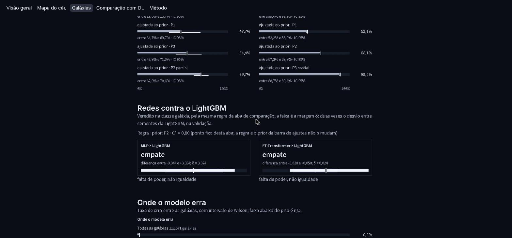
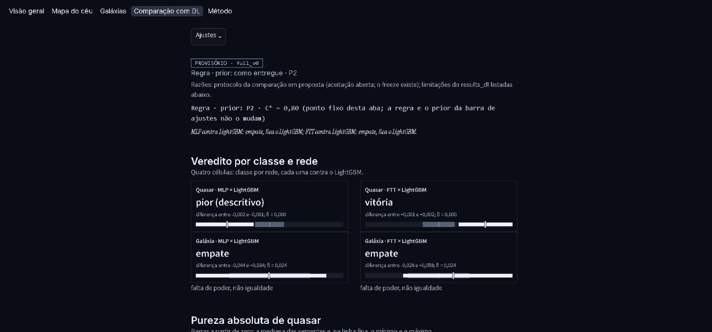
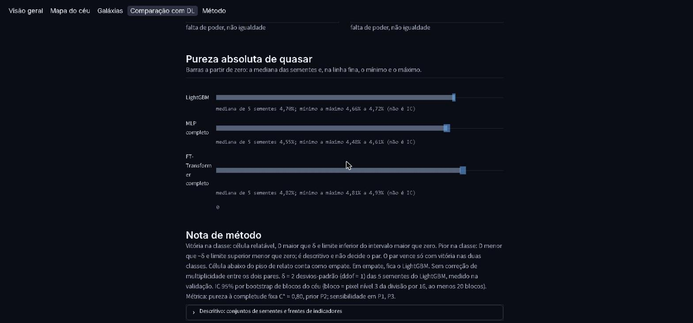
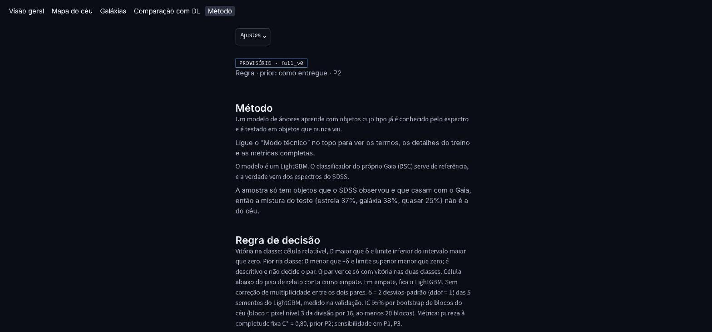
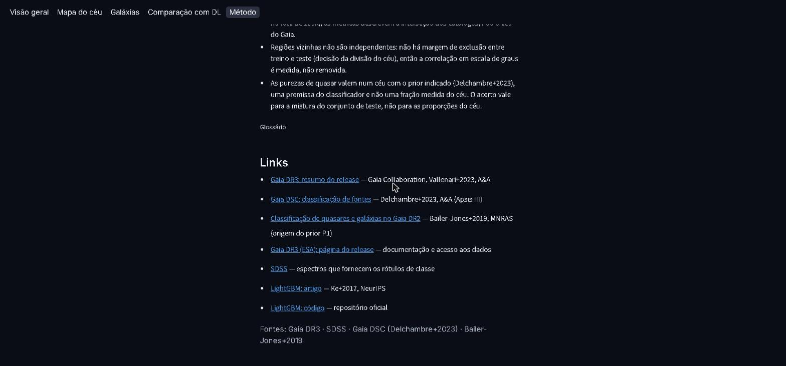

# astro-triage

[English](#english) | [Português](#português)

## English

astro-triage classifies Gaia DR3 sources as STAR, GALAXY or QSO. Labels come from SDSS spectroscopy; the model is LightGBM with calibration, compared against the Gaia DSC classifier as baseline.

> **WARNING: all results are PROVISIONAL.**
> - The reporting floor is not met in some cells.
> - ADR 0006 (deep-learning comparison protocol) is still Proposed: the validation freeze exists, acceptance is open.
> - The population has no magnitude cut (see the ADR 0001 amendment).
>
> Do not cite any number as final.

### Status
- Phase 1 (LightGBM on the `full_v0` dataset, evaluation vs Gaia DSC): done, provisional.
- Layer 2 (Nemotron via NVIDIA API): closed without test evaluation (ADR 0005, Amendment 2).
- Deep-learning comparison (MLP and FT-Transformer vs LightGBM): executed once on the test set under the ADR 0006 protocol; results are aggregates only, provisional, and the test must not be opened again without a new ADR.
- Dashboard (Streamlit): Overview, Sky map, Galaxies, Method and the LightGBM vs deep learning comparison. The Overview, Galaxies and comparison tabs carry a PROVISIONAL seal.

### Dashboard gallery
Screenshots of the dashboard, grouped by tab. The interface text is in Portuguese. Every figure shown is PROVISIONAL.

**Overview**


*Overview, top of the tab: seal, summary cards and the four-rule bars.*


*Overview, bottom of the tab: the bars with their 95% intervals and the links to the other tabs.*

**Sky map**


*Sky map, top of the tab.*


*Sky map: each point is a region centre colored by its error rate; hollow circles mark regions with too few objects to report.*

**Galaxies**


*Galaxies, top of the tab.*


*Galaxies: the neural networks against LightGBM, and where the model errs.*

**Comparison with deep learning**


*Comparison with deep learning, top of the tab.*


*Comparison: absolute quasar purity per model across seeds, and the method note.*

**Method**


*Method, top of the tab.*


*Method: caveats and the list of references and links.*

### How to run
The repository has code, tests and documentation only. **The data are not in the repository**: you need the local data folder to run the full dashboard. Without it the dashboard opens but shows an error (in Portuguese) asking you to set `ASTRO_DATA_ROOT` to the folder that holds `interim/`, instead of results. The tests do not need the data to be collected.

Requirements: Python 3.12 (the pinned versions in `requirements.txt` were smoke-tested on CPython 3.12.5). There is no `pyproject.toml`; dependencies are in `requirements.txt` (`requirements-dl.txt` adds `torch` for the deep-learning comparison and is not needed for the dashboard).

**1. Create the environment and install the dependencies**

PowerShell (Windows):
```powershell
py -3.12 -m venv .venv
.venv\Scripts\python.exe -m pip install -r requirements.txt
```

bash (Linux/macOS/Git Bash):
```bash
python3.12 -m venv .venv
.venv/bin/python -m pip install -r requirements.txt
```
(In Git Bash on Windows, use `.venv/Scripts/python.exe` instead.)

**2. Point to the data**

The dashboard reads `<data root>/interim/<release>/`; the default release is `full_v0`. The data root is the `ASTRO_DATA_ROOT` environment variable when set, otherwise the `data/` folder at the repository root. Set it only if your data live elsewhere:

PowerShell:
```powershell
$env:ASTRO_DATA_ROOT = "D:\path\to\data"
```

bash:
```bash
export ASTRO_DATA_ROOT=/path/to/data
```

**3. Run the tests**

PowerShell:
```powershell
.venv\Scripts\python.exe -m pytest -q
```

bash:
```bash
.venv/bin/python -m pytest -q
```

**4. Start the dashboard** (opens at `http://localhost:8501`)

PowerShell:
```powershell
.venv\Scripts\python.exe -m streamlit run src/astro_triage/dashboard/app.py
```

bash:
```bash
.venv/bin/python -m streamlit run src/astro_triage/dashboard/app.py
```

### Data policy
- No raw data in the repository; terms are in `manifests/README.md`.
- Gaia data licence: CC BY-NC 3.0 IGO.
- Citations are pending verification (see `manifests/README.md`).
- The repository is private.

## Português

O astro-triage classifica fontes do Gaia DR3 como STAR, GALAXY ou QSO. Os rótulos vêm da espectroscopia do SDSS; o modelo é LightGBM com calibração, comparado ao classificador Gaia DSC como baseline.

> **AVISO: todos os resultados são PROVISÓRIOS.**
> - O piso de reporte não é atingido em algumas células.
> - A ADR 0006 (protocolo da comparação com deep learning) segue Proposed: o freeze da validação existe, a aceitação está aberta.
> - A população não tem corte de magnitude (ver a emenda da ADR 0001).
>
> Não cite nenhum número como final.

### Status
- Fase 1 (LightGBM no dataset `full_v0`, avaliação vs Gaia DSC): concluída, provisória.
- Camada 2 (Nemotron via API NVIDIA): encerrada sem avaliação em teste (ADR 0005, Emenda 2).
- Comparação com deep learning (MLP e FT-Transformer vs LightGBM): executada uma vez no teste pelo protocolo da ADR 0006; resultados só em agregados, provisórios, e o teste não pode ser aberto de novo sem uma nova ADR.
- Dashboard (Streamlit): Visão geral, Mapa do céu, Galáxias, Método e a comparação LightGBM × deep learning. As abas Visão geral, Galáxias e Comparação trazem o selo PROVISÓRIO.

### Galeria do dashboard
Capturas de tela do dashboard, agrupadas por aba. Todo valor mostrado é PROVISÓRIO.

**Visão geral**


*Visão geral, topo da aba: selo, cartões-resumo e as barras das quatro regras.*


*Visão geral, base da aba: as barras com seus intervalos de 95% e os links para as outras abas.*

**Mapa do céu**


*Mapa do céu, topo da aba.*


*Mapa do céu: cada ponto é o centro de uma região, colorido pela taxa de erro; círculos vazados marcam regiões com poucos objetos para reportar.*

**Galáxias**


*Galáxias, topo da aba.*


*Galáxias: as redes neurais contra o LightGBM e onde o modelo erra.*

**Comparação com DL**


*Comparação com DL, topo da aba.*


*Comparação: pureza absoluta de quasar por modelo entre as sementes, e a nota de método.*

**Método**


*Método, topo da aba.*


*Método: ressalvas e a lista de referências e links.*

### Como executar
O repositório tem só código, testes e documentação. **Os dados não estão no repositório**: o dashboard completo exige a pasta de dados local. Sem ela o dashboard abre, mas mostra um erro pedindo para definir `ASTRO_DATA_ROOT` com a pasta que contém `interim/`, no lugar dos resultados. Os testes são coletados sem os dados.

Requisitos: Python 3.12 (as versões fixadas em `requirements.txt` foram testadas no CPython 3.12.5). Não há `pyproject.toml`; as dependências estão em `requirements.txt` (`requirements-dl.txt` acrescenta o `torch` da comparação com deep learning e não é necessário para o dashboard).

**1. Criar o ambiente e instalar as dependências**

PowerShell (Windows):
```powershell
py -3.12 -m venv .venv
.venv\Scripts\python.exe -m pip install -r requirements.txt
```

bash (Linux/macOS/Git Bash):
```bash
python3.12 -m venv .venv
.venv/bin/python -m pip install -r requirements.txt
```
(No Git Bash do Windows, use `.venv/Scripts/python.exe`.)

**2. Apontar para os dados**

O dashboard lê `<raiz dos dados>/interim/<release>/`; a release padrão é `full_v0`. A raiz dos dados é a variável de ambiente `ASTRO_DATA_ROOT`, quando definida, ou a pasta `data/` na raiz do repositório. Defina a variável só se os dados estiverem em outro lugar:

PowerShell:
```powershell
$env:ASTRO_DATA_ROOT = "D:\caminho\para\data"
```

bash:
```bash
export ASTRO_DATA_ROOT=/caminho/para/data
```

**3. Rodar os testes**

PowerShell:
```powershell
.venv\Scripts\python.exe -m pytest -q
```

bash:
```bash
.venv/bin/python -m pytest -q
```

**4. Iniciar o dashboard** (abre em `http://localhost:8501`)

PowerShell:
```powershell
.venv\Scripts\python.exe -m streamlit run src/astro_triage/dashboard/app.py
```

bash:
```bash
.venv/bin/python -m streamlit run src/astro_triage/dashboard/app.py
```

### Política de dados
- Nenhum dado bruto no repositório; os termos estão em `manifests/README.md`.
- Licença dos dados Gaia: CC BY-NC 3.0 IGO.
- Citações pendentes de verificação (ver `manifests/README.md`).
- O repositório é privado.
